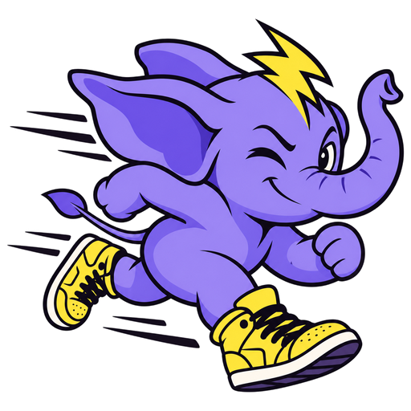

# Pun design system

Pun is one fast Rust binary for the whole PHP toolchain: `pun format`, `pun lint`, `pun analyse`, `pun check`, and `pun migrate`. It is to PHP what Bun is to JavaScript.

The brand is **Sticker Pop**: cream paper, pastel fills, thick ink outlines, and hard offset shadows, like a laptop lid covered in stickers. The surface is loud and cheeky. Underneath, every claim is a number that the repo can reproduce.

## Voice

Pun talks like a fast friend who also reads the benchmark methodology.

- **Lead with the number, then the joke.** "Format laravel/framework in 3.7 s. Pint takes 190." Use one pun or wink per page, and none in docs headings.
- **Keep it short.** Headlines have fewer than eight words. A lede is one sentence: "One Rust binary for format, lint, analyse and migrate."
- **Use concrete nouns.** Name the tool that Pun replaces (Pint, PHP-CS-Fixer, Rector, PHPStan, Larastan), the file (`pint.json`, `pun.toml`), and the flag (`--test`). Do not write "blazing", "revolutionary", "seamless", or "supercharge".
- **Prove it.** Publish only timings that the repo measured. Today that is laravel/framework: Pint 190 s, Pun 3.7 s cold and 0.07 s warm, which gives "51×". Every chart links to "reproduce →".
- **Casing.** The product is "Pun" in sentences. It is "pun" in the wordmark, in commands, and in the Ribbon. Headings and buttons use sentence case. Commands are always in mono, with a `$` prompt.
- **No emoji** in product UI or docs. The mascot and the bolt carry the personality.
- **Say "you", not "we".** Write "your pint.json" and "your CI". Use "we" only in the changelog.

Copy that you can reuse:

- "PHP tooling, zero waiting."
- "Four tools. One binary."
- "Same bytes as Pint."
- "Blink and it's done."
- "Stop waiting on your tools."
- "Made for PHP people who hate waiting."

## Color

The system has two themes: **Paper** (light, the default) and **Night** (dark). Most surfaces are neutral. Color comes in flat, outlined stickers.

### Surfaces and text

- The ground is `paper`.
- Sunken bands and the docs sidebar use `paper-2`.
- Every sticker surface (cards, buttons, pills) uses `card`.
- Text is `ink`. Secondary text is `ink-2`. Captions and kickers are `ink-3`.
- Links are `lilac-deep`, the only brand color used as text.

### Fills

Each of the four fills has one job:

- `zap` means speed. It fills the one primary Button, Highlight words, the bolt, Format, and Pun's cold-run bar.
- `lilac` is the brand ground. It fills the hero StickerPanel, the app icon, and Analyse.
- `gum` means play. It fills Bursts, the closing CTA, the warm-cache bar, and the `$` prompt.
- `mint` means ready. It fills status Tags and the version chip.

Text on any fill is always `ink`. The lowest contrast is 7.6:1, on `gum`. Fills have only 1.2:1 to 2.2:1 contrast against `paper`, so every fill gets the `outline`. The outline is the brand. Never drop it.

`grape` and `grape-deep` are the mascot's own colors. Use them only on grounds next to the mascot.

### Status and code

- Status text uses `ok` (blue) and `bad` (orange-red). Always pair it with a ✓ or ✗ glyph, or with a word, so that no one has to tell red from green.
- Code, terminals, and the InstallBox use `code-bg` in both themes. They use `code-add`, `code-del`, `code-dim`, and `zap` for the hot result line.

### Night theme

In Night, outlines turn light (`outline`) and hard shadows turn `#5B3FD9`. Stickers still lift off the dark ground.

## Type

The system uses two families, both from Google Fonts:

- **Fredoka** (`display`) for everything that people read.
- **Martian Mono** (`mono`) for everything that people type or measure.

Fredoka's round terminals and circular bowls match the hand-drawn "pun" lettering in the wordmark. Headlines, body copy, buttons, and the logo read as one voice.

- Headlines are bold (700) with light negative tracking, from -0.01em to -0.03em. Rounded letters need more air than a grotesque.
- Headline sizes: `display` for the hero, `h1` for sections, `h2` for docs and the CTA, `h3` for cards.
- `mega` is for the one speed multiple on a page (51×).
- Body copy is `body` at 16/1.6, with a maximum width of 68ch. A lede is `lede` in `ink-2`, with a maximum width of 30ch.
- Mono covers commands, flags, file names, numbers in charts, Tags, Pills, and the uppercase `kicker` above section headlines.
- Never set "pun" in a font as a logo. Use the wordmark SVG.

## Shape, depth, and texture

- **Outline:** use `stroke` (3px) on cards, buttons, panels, and code. Use `stroke-thin` (2px) on Pills, Tags, and kbd.
- **Radius:**
  - `radius-pill` for Buttons, Tags, and bars.
  - `radius-lg` for cards and code.
  - `radius-xl` for hero and CTA panels.
  - `radius-md` for the InstallBox and icon tiles.
  - `radius-sm` for copy buttons and small tiles.
- **Shadow:** use hard offsets only, with no blur.
  - `pop` is the default.
  - `pop-sm` is for small things.
  - `pop-lg` is for panels.
  - `pop-lilac` is only for the InstallBox.
  - On hover, an element lifts: `translate(-2px,-2px)` and `pop-hover`.
  - On press, it sinks: `translate(3px,3px)` and `pop-press`.
- **Tilt:**
  - ToolCards in a row alternate between `tilt-card` at -1deg and +1deg.
  - Each headline gets one sticker Highlight at `tilt-word`.
  - Loose tags use `tilt-sticker`.
  - Bursts use `tilt-burst`.
  - Each page gets one Ribbon at `tilt-ribbon`.
  - Body text, tables, and code are never tilted.
- **Texture:** `dot-grid` at 15% on lilac panels. `stripe` marks the slow lane (competitors) in benchmarks.
- **Spacing:** the base unit is 4px. Card padding is `space-6`, and card gaps are `space-5`. Sections sit `space-24` apart. The closing CTA sits `space-28` after the last section.
- **Focus:** every interactive element gets a 3px solid `focus` ring with a 3px offset.

## Motion

Motion is quick and physical:

- Lift and press take 120 to 150ms with an ease curve.
- The Ribbon runs a 30s linear loop.
- An arrow nudges 3px on hover.
- Nothing fades in on scroll.
- Everything stops under `prefers-reduced-motion`.

## Mascot and logos

- The **mascot** is the sprinter elephant (Assets > Mascot). It has grape skin, yellow high-tops, a bolt cowlick, and a wink. Use it in hero panels, the docs sidebar, the 404 page, and social cards. It always faces right and runs forward.
- The **wordmark** (Assets > Logos) is the bolt plus hand-built "pun" lettering. Use `pun-wordmark.svg` on light grounds and `pun-wordmark-reverse.svg` on dark grounds.
- The **bolt** alone is the small mark. Use it for the favicon, avatars, and Ribbon separators.

## Iconography

The system has no icon font. Status uses text glyphs from the CLI itself: ✓ for pass, ✗ for fail, ➜ for the current line, and `$` for the prompt. Tool tiles use a single capital letter (F, A, L, E). The bolt is the only drawn icon.

If a UI needs more icons, use an outline set with a 2px stroke at 20px in `ink`. Add the set to this page first.

## Layout

- **Marketing pages:** the maximum width is 1200px, with 56px of side padding. The hero has two columns, with copy on the left and the mascot panel on the right. Sections stack, each with a kicker, an `h1`, and one visual. See the LandingPage card.
- **Docs:** a 250px sidebar on `paper-2`, a 68ch article, and a 200px "On this page" rail. See the DocsPage card.
- **Phones:** one column with a 24px gutter. ToolCards sit single file, without tilt. `display` drops to 56px, and `mega` drops to 120px.
